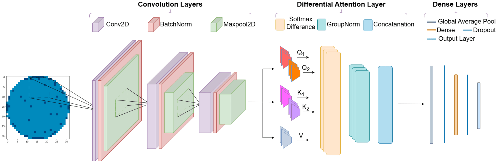

# DiffWaferNet

DiffWaferNet is a lightweight deep learning framework for wafer map defect classification. It combines a CNN backbone, a differential attention module, and a class-conditional augmentation strategy to improve performance on imbalanced wafer defect patterns while keeping the model efficient.

<p align="center">
  
</p>

## Paper

Read the full paper on ResearchGate [https://www.researchgate.net/publication/416922739].

## Highlights

- Lightweight CNN + differential attention architecture
- Synthetic minority-sample generation for class imbalance
- 8 wafer defect classes plus normal wafers
- Evaluation with confusion matrix and macro metrics
- Suitable for research and practical defect inspection workflows

## Dataset

This project uses the WM-811K wafer map dataset.

- Dataset: WM-811K
- Source: [Kaggle](https://www.kaggle.com/datasets/qingyi/wm811k-wafer-map)
- Classes: Center, Donut, Edge-Loc, Edge-Ring, Loc, Random, Scratch, Near-Full

For a full dataset description and usage notes, see [data/DATASET.md](data/DATASET.md).

> Dataset files are not included in this repository because of size limits. Download the dataset from Kaggle and place it in the project data directory before running experiments.

## Project Structure

- `code/` — training and analysis notebooks
- `data/` — dataset files and dataset notes
- `outputs/` — trained model and evaluation artifacts
- `figures/` — model and visualization assets
- `requirements.txt` — Python dependencies

## Quick Start

#### 1. Upload the Required Files

Upload the notebook, dataset, and any other required project files to Google Colab. To upload local files manually:

```python
from google.colab import files

uploaded = files.upload()
```

#### 2. Install dependencies

```bash
pip install -r requirements.txt
```

In a Colab notebook cell, use `!pip install -r requirements.txt`.

#### 3. Load the Dataset

```python
import pickle

with open("data/LSWMD.pkl", "rb") as f:
    data = pickle.load(f)
```

Update the file path to match your dataset location.

#### 4. Train the Model

Open and run the notebook:

```text
code/diffwafernet.ipynb
```

Ensure that dataset paths, dependencies, and model settings are correct before training.

## Example Inference

This example illustrates a general inference workflow. Adapt the input format and preprocessing to match the saved model.

```python
import pickle
import numpy as np
import tensorflow as tf

model = tf.keras.models.load_model("outputs/diffwafernet.keras", compile=False)
```

## Citation

Uddin, M. R., Islam, M. S., Farid, F. A., Uddin, J., & Mansor, S. B. (2026). DiffWaferNet: A lightweight differential attention-based network for wafermap defect classification. *PeerJ Computer Science, 12*, e3947. https://doi.org/10.7717/peerj-cs.3947

```bibtex
@article{uddin2026diffwafernet,
  author  = {Uddin, Md Ryhan and Islam, Md Saiful and Farid, Fahmid Al and Uddin, Jia and Mansor, Sarina Binti},
  title   = {DiffWaferNet: A lightweight differential attention-based network for wafermap defect classification},
  journal = {PeerJ Computer Science},
  volume  = {12},
  pages   = {e3947},
  year    = {2026},
  doi     = {10.7717/peerj-cs.3947},
  url     = {https://doi.org/10.7717/peerj-cs.3947}
}
```
